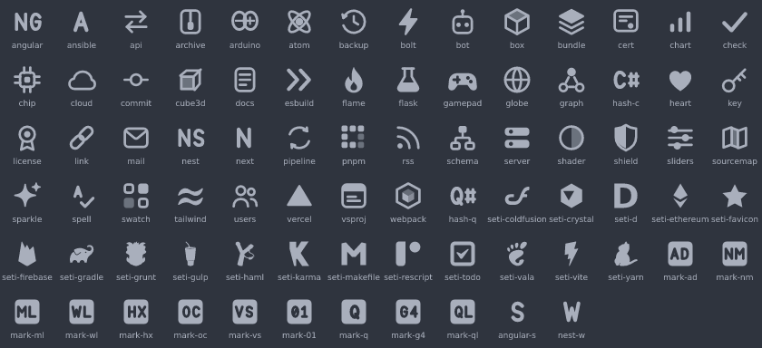

# Authentic Icons for Zed

Zed's own file icons, extended to every file type the
[vscode-icons for Zed](https://github.com/vscode-icons/vscode-icons-zed) theme knows about.
Every icon Zed already draws is kept exactly as it is. A new icon uses VS Code's own file-icon
shape (its built-in Seti theme) when VS Code has one *that is still legible at 16px*. Otherwise it
is drawn in Zed's style: 16×16, monochrome, 1.2px rounded outlines. All new icons use Zed's colours.



## The problem

Zed's default icon theme draws about 80 file types in one consistent line-art style. Everything
else falls back to a generic "page" icon: `package.json`, `webpack.config.js`, `.env`, `LICENSE`,
and even `.cs`, `.sln` and `.csproj`, which Zed lists but leaves blank. The vscode-icons theme
fixes coverage. It knows about 2,900 file names and extensions, but it swaps Zed's look for
colourful VS Code icons. This theme keeps Zed's look and adds that coverage.

## How it decides what each file gets

There are three rules, applied to every name and extension that vscode-icons-zed covers.

1. **Zed already draws it: leave it alone.** The theme doesn't even contain these entries. Zed
   loads an extension icon theme by laying its tables *on top of* Zed's own. When the theme
   names an icon key it doesn't define, Zed falls back to its own icon for that key (see
   `load_icon_theme` in `crates/theme/src/registry.rs` and `get_icon_for_type` in
   `crates/file_icons`). So `main.rs` still shows Zed's actual Rust icon, and it will follow
   Zed if Zed ever redraws it. None of Zed's SVGs are copied.
2. **Zed lists it but draws a blank: fill the blank.** Zed maps `.cs`, `.csproj`, `.sln`,
   `.suo`, `.bak`, `.bicep`, `.cr`, `.cue`, `.sol` and a few others to its generic icon. The
   theme defines real icons under Zed's own key names, so Zed's existing mappings light up.
3. **Zed doesn't know it: reuse Zed's icon for the same concept if there is one, otherwise use
   VS Code's shape, and failing that, draw one.** `Cargo.toml` gets Zed's Rust icon, `Gemfile`
   gets Ruby, `Dockerfile.dev` gets Docker, and `.aiff`, which Zed doesn't list, gets Zed's
   audio icon. `.gradle`, `.haml`, Karma and Vite configs get VS Code's Gradle, Haml, Karma and Vite
   shapes. `package.json` and `webpack.config.js` get a drawn package box and webpack cube.
   Types neither editor draws get a drawn glyph or a letter badge.

Here is how one name goes through Zed's lookup. Zed tries the whole file name first, then each
dotted suffix from longest to shortest, then the part before the first dot. For
`webpack.config.js`, the whole name is in this theme, so Zed shows the theme's webpack icon. Without
the theme it would have fallen through to `js` and shown the JavaScript icon. For `user.test.ts`,
`user.test.ts` isn't mapped, but `test.ts` is: a flask, for tests. For `main.rs`, the theme maps
nothing, so Zed's own `rs` entry wins.

New icons come in three forms.

- **VS Code shapes** (17 icons, used by 23 file types) are glyphs of Seti, VS Code's built-in
  file-icon theme: Gradle, Haml, Karma, Vite, Yarn, ColdFusion and a few more. They are taken
  from its icon font, recoloured to Zed's grey, and fitted to Zed's 12px content box. Seti
  draws about 150 shapes for an icon font at 150% size, and at 16px most of them fall apart:
  wordmarks like npm's, fine logos like Jenkins' butler or Perl's camel, and a C# whose `#` is
  thinner than a pixel. A shape is only used where it passes two tests. It has to lose at most
  8 px² of detail at real size, and it has to still be recognisable on screen. Shapes that
  failed (`npm`, `webpack`, `C#`, `Perl`, `Jinja`, `Haxe`, and more: 57 of the original 80 file
  types) and were replaced.
- **Drawn glyphs** stand for a shared idea and serve a whole family of tools, the way Zed uses
  one book icon for every document: a flask for test runners, a cloud for hosting, a shield for
  security scanners, a check for linters, a loop for CI, a sparkle for AI tools.
- **Letter badges** cover languages and tools with no widely known shape. Each is laid out like
  Zed's own TypeScript badge: a 12×12 rounded square with one or two letters knocked out. The
  letters are a small smooth typeface drawn for the theme, with true curves, so they stay smooth
  on any screen (see [Legibility](#legibility)). Ada gets `AD` and Objective-C gets `OC`.

The drawings follow the conventions of Zed's own set, and that is what keeps them from looking
pasted on:

- Generic glyphs are 1.2px outlines with a single solid or 50% accent. Zed's package icon fills
  one face and its gear fills the hub; here the flask holds solid liquid, the box has a two-tone
  lid, and the shield is half filled.
- Brand-like marks have no frame. Zed draws C, C++ and the terminal as solid silhouettes, and
  this theme first did the same for C#, Angular, Ansible, Next and esbuild. Inside a disc, hexagon
  or shield the letter had about 6px to work with and the `#` of C# read as an `H`, so these marks
  are now the letters (`C#`, `N`, `A`) or shapes (a tick, a double chevron) alone, drawn about 10px
  tall.
- Curves are true curves, and nothing is smaller than the size Zed shows it at.

## Legibility

An icon is 16px tall in Zed's project panel, so that is the size every new icon is judged at,
not the zoomed-in size it looks good at. These rules follow from that.

- **No feature thinner than 1px, no gap narrower than about 1.4px.** Thinner details vanish
  when the icon is rasterised. Several first-draft glyphs failed this (the `#` in C#, a chip's
  pin marker, a zipper's teeth) and were redrawn bolder.
- **Smooth letters, not pixel art.** An earlier version set the badge letters in a 4×6 pixel
  font, which is the sharpest possible text at exactly 16px. But on a 2× screen, or anywhere an
  icon is scaled, its diagonals show as visible stair-steps next to Zed's smooth vector icons,
  and C# looked pixelated beside C and C++. The typeface is now drawn with real curves. Its
  height is exactly 6px, so the top and bottom edges land on whole pixels and stay crisp. Its
  1.3px strokes are heavy enough to hold up at 16px.
- **Straight strokes sit on pixel centres.** A 1.2px line centred on the edge between two pixels
  is two 60% pixels, which looks blurry; centred on a pixel it is one crisp pixel with a faint
  halo. The drawing kit (`tools/kit.py`) moves every horizontal or vertical line and rectangle
  outline to the nearest pixel centre, and solid blocks (server units, chart bars, pnpm's
  blocks, swatch cells) are drawn on whole pixels. Docs, bot, archive, cert and sliders went
  from mid-grey edges to sharp ones. Curves and diagonals can't be aligned, and a line exactly
  through the middle of the icon (x or y = 8) stays put so mirrored shapes stay mirrored.
- **Two letters have to fit in about 10px.** A wide letter like `M` or `N` leaves little room
  for the gaps inside it, so a few pairs stay dense (`NM`, `MN`, `ML`). They still read, and
  they keep the letters people expect, so `matlab` is `ML` and `nginx` is `NG`. Where a clearer
  pair was just as natural, it was used (`QL` for QML, `DE` for Deno, `BO` for Bower). A pair
  that can't fit is a build error rather than a squashed icon.
- **`#` needs more room than other letters.** In C# the hash is lighter than the letter, so its
  centre cell stays open. At the usual weight, and inside a frame, it merged into an `H`. C# and
  Q# therefore have no frame and use nearly the whole icon. The hash is drawn smaller than the
  letter (7.5px against 9px tall) so the C and Q keep their normal width; at full size the pair
  had to be squeezed and the C came out narrow.
- **One letter per framework role.** Angular and NestJS role icons (`*.service.ts`, `*.guard.ts`)
  show a single large letter with no frame around it. Angular and NestJS themselves are `NG` and
  `NS`, Next is `N` and Ansible is `A`.

`python3 -I tools/preview.py` writes `preview.html`: every new icon at 100% on Zed's dark and
light panel backgrounds, using `` tags, which is how Zed draws extension icons. Judge it at
100% browser zoom.

## Colour

Zed treats the two kinds of icon differently. It tints its *built-in* icons at draw time with the
UI theme's muted text colour (`text.muted`; the project panel and tabs both use it). But it draws
an extension theme's icons as plain images, in whatever colours the SVG contains, because that is
how colourful themes like vscode-icons work (`IconSource::External` in `crates/ui`). Its SVG
image path also resolves `currentColor` to black, so an extension icon cannot follow the UI
theme.

So the new icons carry their colour baked in. They are written twice: in One Dark's `#a9afbc`
for **Authentic Icons**, and in One Light's `#58585a` for **Authentic Icons Light**. These are
the muted colours of Zed's default UI themes, so in those themes the new icons are
indistinguishable from Zed's own. Zed's own icons in this theme are still tinted live. With
another UI theme, the new icons keep the One Dark/One Light grey while Zed's follow the theme.
To match it, rebuild with that theme's `text.muted` colour (see below).

## Install

In Zed, run **zed: install dev extension** from the command palette and choose this folder. Then
pick the theme with **icon theme selector: toggle**, or set it in `settings.json` so the icon
theme follows light and dark mode:

```json
{ "icon_theme": { "mode": "system", "light": "Authentic Icons Light", "dark": "Authentic Icons" } }
```

After rebuilding, refresh the extension with the **Rebuild** button next to it on Zed's
Extensions page, or restart Zed.

Two variants follow vscode-icons' framework flavours. **Authentic Icons (Angular)** and
**Authentic Icons (NestJS)** add role-named files (`*.component.ts`, `*.service.ts`,
`*.guard.ts`, ...) shown as the role's initial. They are separate
themes because both frameworks claim the same suffixes. vscode-icons' "Official" flavour only
swaps the JavaScript, TypeScript and YAML logos, which this theme leaves to Zed, so it has no
counterpart here.

## Changing or regenerating the theme

`icons/` and `icon_themes/` are generated. Edit the sources in `tools/` and rebuild:

```sh
python3 -I tools/build.py   # writes icons/{dark,light}/*.svg and icon_themes/authentic-icons.json
python3 -I tools/check.py   # replays Zed's lookup and asserts the rules above hold
python3 -I tools/preview.py # writes preview.html to inspect every icon at real size
```

To match a UI theme other than One Dark and One Light, look up its `text.muted` colour in the
theme's JSON and pass it in. For example, for Gruvbox:

```sh
python3 -I tools/build.py --dark '#c5b597' --light '#5f5650'
```

To change what a file type gets, edit its line in `tools/design/*.txt`; `s:<seti id>` picks any
VS Code shape (the ids are in `tools/seti.json`). To draw a new glyph,
add a function to `tools/glyphs.py`, using the helpers in `tools/kit.py` so it keeps Zed's
stroke weight and margins. To pick up new file types after vscode-icons-zed or Zed changes,
refresh the coverage list from checkouts of both repositories. The script only reads files from
them:

```sh
python3 -I tools/extract_coverage.py <zed checkout> <vscode-icons-zed checkout> tools/coverage.json
python3 -I tools/build.py   # fails and lists any new key that still needs a design line
```

To refresh the VS Code shapes from a checkout of microsoft/vscode, which needs only
`extensions/theme-seti`, run the extractor. It reads the Seti icon font with the standard
library alone:

```sh
python3 -I tools/extract_seti.py <vscode checkout> tools/seti.json
```

## Costs and limits

- **New icons can't follow the UI theme's colour.** That's how Zed draws extension icons (see
  [Colour](#colour)). The defaults match Zed's default themes exactly; other themes need a
  rebuild with their colour.
- **The theme relies on Zed's merge-and-fallback loading.** The behaviour was read from Zed's
  source. `check.py` replays it, but it can't notice if a future Zed changes it. If Zed stopped
  falling back, names pointed at Zed's icons (`zed:` lines) would show the generic icon until
  rebuilt with copies.
- **Matching is case-sensitive in Zed, but not in VS Code.** vscode-icons lists some names only
  in lower case (`gemfile`, `vagrantfile`, `claude.md`). So the build also adds the usual
  capitalised `*file` spelling (`Gemfile`, `Vagrantfile`, `Taskfile.yml`), and upper-case
  spellings for a short list of names that are conventionally capitalised (`CLAUDE.md`,
  `AGENTS.md`, `CODEOWNERS`, `COPYING`). Other case variants are not guessed.
- **Folders keep Zed's default icons.** vscode-icons' 500+ named folder icons are not
  reproduced, because Zed's style has no folder variants to extend.
- **Shared icons are intentional.** 329 icon files cover 863 file types, plus 51 framework
  roles. Related tools share a glyph, and a few families share a badge (VB/VBA, Idris's file
  kinds). Drawn brand marks are simplified line art, not the official logos.
- **A few dense letter pairs.** Marks such as `NM`, `MN` and `ML` are tighter than the rest,
  because two wide letters leave little room inside a 12px badge.
- **Only names vscode-icons lists are covered.** VS Code's Seti theme also knows about 117 names
  that neither Zed nor vscode-icons lists (`Jenkinsfile`, Bazel's `BUILD` and `WORKSPACE`,
  `.hx`). VS Code also recognises `Makefile` through language detection. These are not added.

## Reference

| Path | What it is |
| --- | --- |
| `extension.toml` | Extension manifest |
| `icon_themes/authentic-icons.json` | Generated themes: Authentic Icons and Authentic Icons Light, each plus Angular and NestJS variants |
| `icons/dark/`, `icons/light/` | Generated SVGs (only the new icons), baked in the dark and light colour |
| `tools/coverage.json` | Names Zed lacks, grouped by vscode-icons key, plus a copy of Zed's default tables |
| `tools/design/*.txt` | One line per key: `zed:<key>` reuses Zed's icon, `s:<id>` a VS Code (Seti) shape, `g:<glyph>[:args]` a drawn glyph, `m:<AB>` a letter badge, and `@<key>` fills a Zed blank key |
| `tools/seti.json` | VS Code's Seti glyph outlines and its name/extension maps (generated by `extract_seti.py`) |
| `tools/glyphs.py`, `tools/kit.py` | The drawings and the shared drawing style |
| `tools/build.py`, `tools/check.py`, `tools/preview.py` | Generator, self-check, and the real-size preview page |
| `tools/extract_coverage.py`, `tools/extract_seti.py` | Refresh the coverage list and the VS Code shapes from their sources |
| `THIRD_PARTY_NOTICES.md` | Licence notices for the VS Code / Seti UI shapes |

The coverage list comes from vscode-icons-zed (MIT) at commit `f52dc01`. The design rules and
Zed's tables come from Zed's source, and no Zed or vscode-icons artwork is copied. The VS Code
shapes come from the Seti theme in microsoft/vscode (MIT; Seti UI by Jesse Weed, MIT). Their
notices are in `THIRD_PARTY_NOTICES.md`. The theme is licensed MIT.
